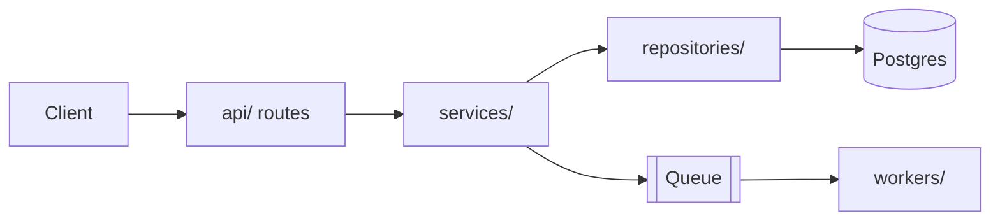

# Mode: Architecture map

## Questions to answer
1. What are the main modules/components and their responsibilities?
2. Which layer is each in (presentation, application, domain, persistence, infrastructure)? Which style (layered, hexagonal, MVC, event-driven, pipeline, microservices)?
3. How do they depend on each other? Any cycles or layer violations?
4. What are the 2–3 key flows end to end (entry → logic → storage → response)?
5. External systems: databases, queues, caches, third-party APIs, cloud services — where are they called from?
6. Where does state live? Configuration? Secrets? How is it deployed?

## How
- Map directories → modules → layers. Confirm with imports, not names: `rg -n "^import|^from|require\(" <dir> | ...`.
- Build an import/dependency graph with available tools (madge, pydeps, go mod graph, cargo tree, jdeps, dependency-cruiser) or grep.
- Trace flows by following calls from an entry point; note file:line at each hop.
- Find integrations: grep for DB clients, HTTP clients, SDKs, env var reads.

## Report template
```markdown
## Architecture
**Type / style:** <e.g. web backend, modular monolith, hexagonal-ish>
**Stack:** <languages, frameworks, datastores, infra>

### Components
| Component | Path | Layer | Responsibility | Depends on |
|---|---|---|---|---|

### Diagram


### Key flows
1. <Flow name>: `a.ts:12` → `b.ts:40` → `c.ts:88` → DB table `orders`

### External dependencies
| System | Used for | Called from |
|---|---|---|

### Observations
- Layer violations / cycles (with file:line)
- Coupling hotspots
```
