# Diagram templates (Mermaid)

Each block is valid Mermaid — all rendered with mermaid-cli 11.4.2 on 2026-11-21. Replace names; keep the structure.

## Context (C4 level 1, as flowchart)
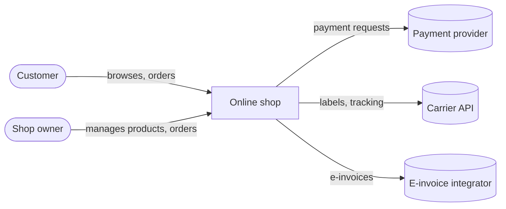

## Containers / components
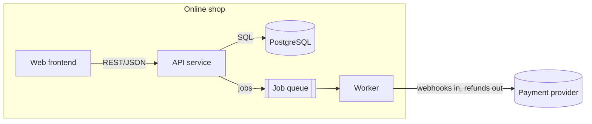

## Sequence
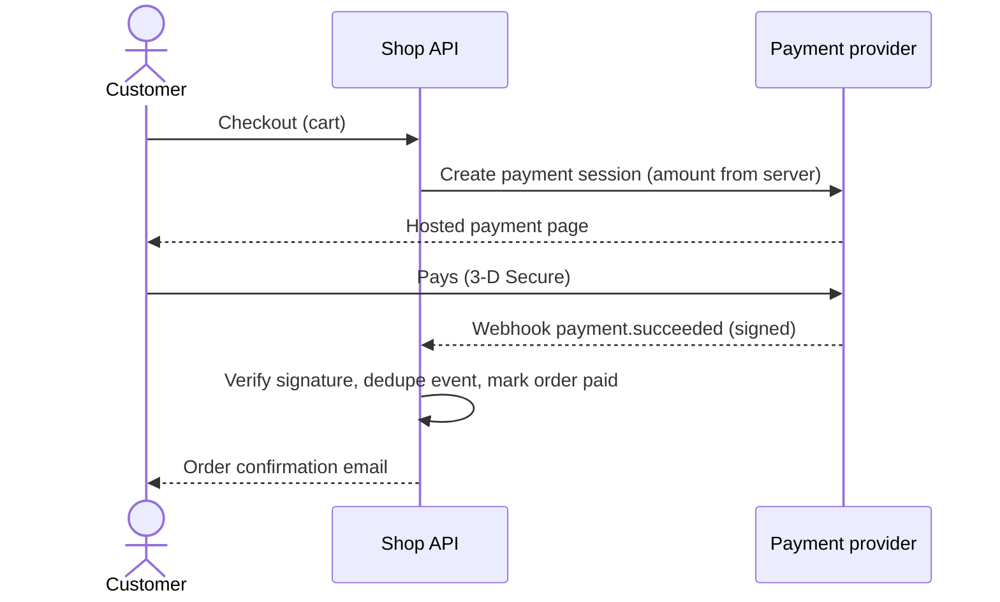

## Flowchart with decisions
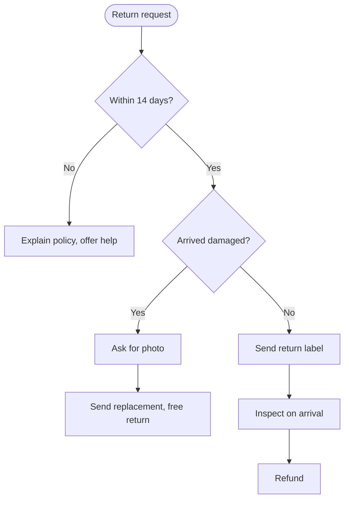

## ER diagram
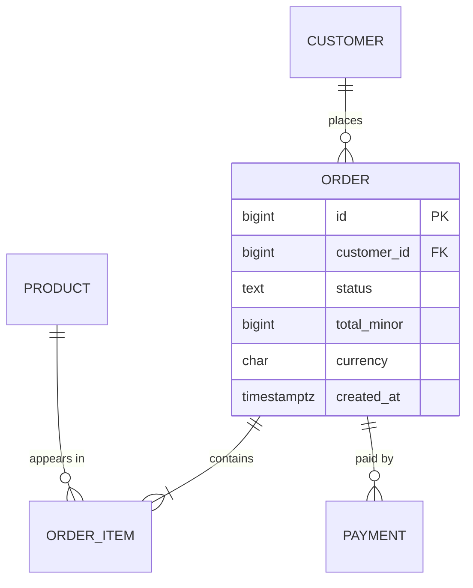

## State machine
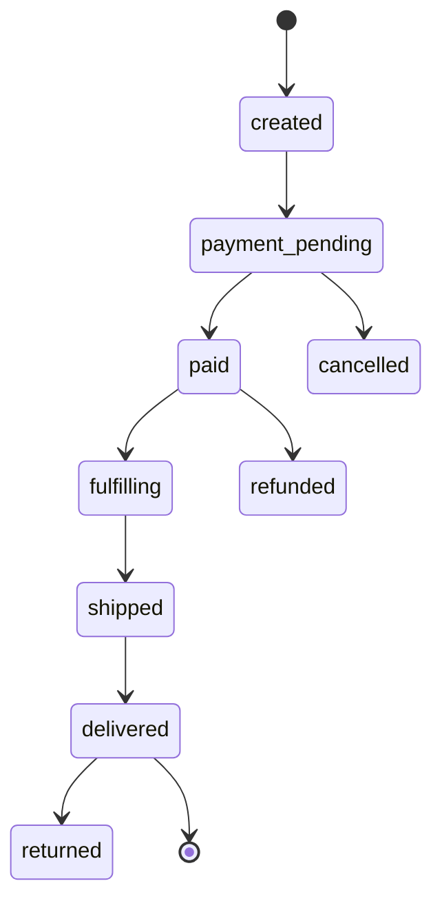

## Deployment / infrastructure
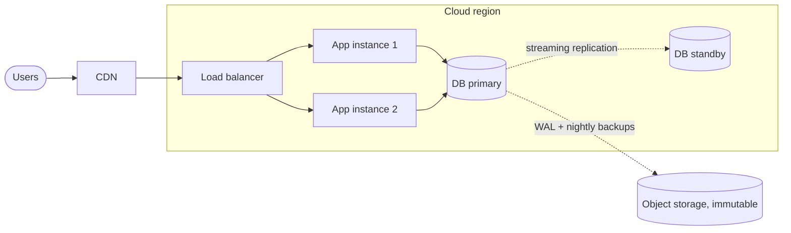

## Swimlane process (as subgraphs)
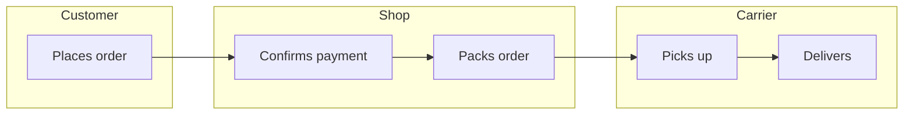

## User journey
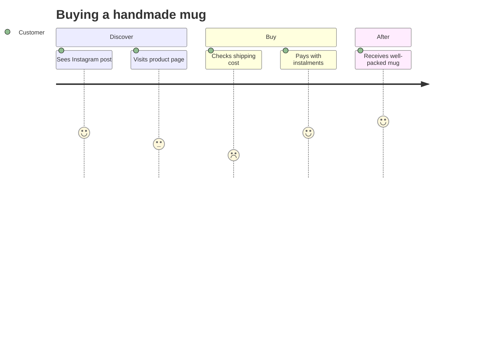

## Timeline / Gantt
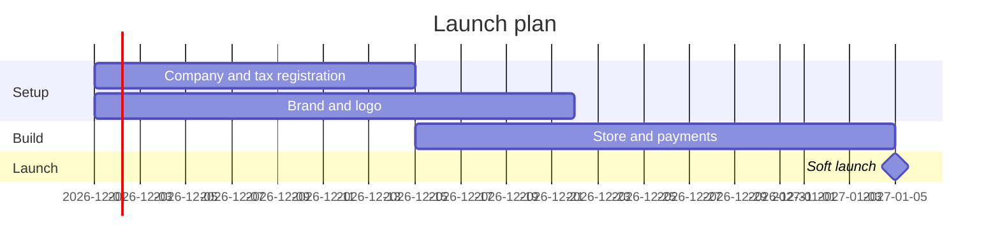

## Mind map / knowledge map
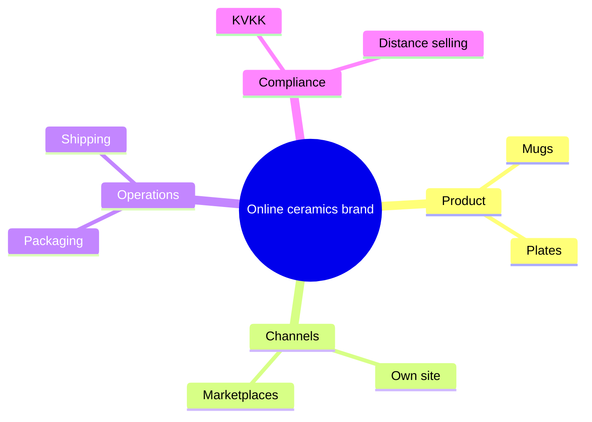

## Other tools
PlantUML (rich UML, C4-PlantUML library) · D2 (clean layouts, good for architecture) · Graphviz DOT (large generated dependency graphs) ·
Excalidraw/draw.io (hand-drawn or free-form, keep the source file in the repo).
